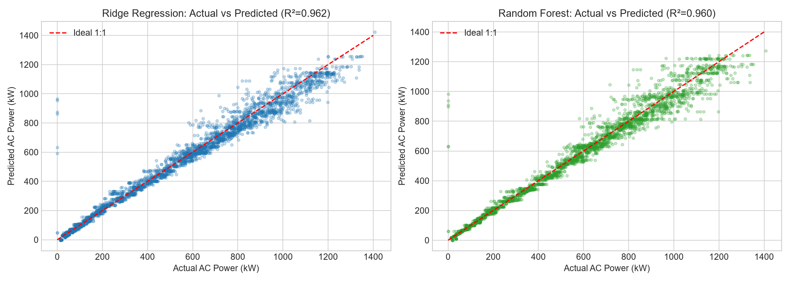
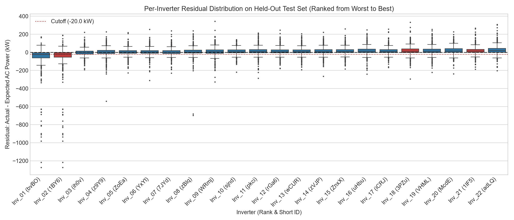
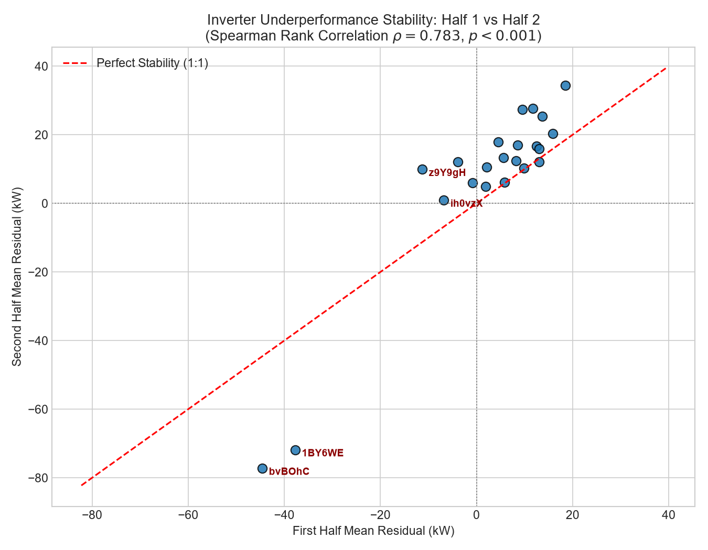

# Solar Inverter Underperformance Identification

A predictive analytics project investigating weather-based expected-power modeling to identify solar photovoltaic (PV) inverters that consistently underperform, and evaluating the temporal stability of those underperformance flags.

---

## 1. Problem & Research Question
Solar power plants rely on multiple multi-string inverters operating in parallel. Because solar irradiance and ambient temperatures fluctuate continuously throughout the day, low power output alone does not indicate whether an inverter is malfunctioning or simply experiencing cloudy conditions.

**Research Question**:  
*Can a weather-based expected-power model identify inverters that consistently underperform, and are those underperformance flags stable over time?*

---

## 2. Dataset & Attribution
- **Dataset**: [Solar Power Generation Data (Kaggle)](https://www.kaggle.com/datasets/anikannal/solar-power-generation-data) by Ani Kannal.
- **Scope**: Two grid-connected solar PV plants in India monitored over 34 consecutive days (May 15, 2020 to June 17, 2020) at 15-minute intervals.
- **Data Files**:
  - `Plant_1_Generation_Data.csv` & `Plant_2_Generation_Data.csv`: Inverter-level power generation (`DATE_TIME`, `PLANT_ID`, `SOURCE_KEY`, `DC_POWER`, `AC_POWER`, `DAILY_YIELD`, `TOTAL_YIELD`).
  - `Plant_1_Weather_Sensor_Data.csv` & `Plant_2_Weather_Sensor_Data.csv`: Plant-level meteorological readings (`DATE_TIME`, `AMBIENT_TEMPERATURE`, `MODULE_TEMPERATURE`, `IRRADIATION`).

---

## 3. Methodology
1. **Data Cleaning & Harmonization**:
   - Resolved heterogeneous timestamp formats: Plant 1 generation logged as `%d-%m-%Y %H:%M` vs. weather and Plant 2 logged as `%Y-%m-%d %H:%M:%S`.
   - Verified zero duplicate timestamps per inverter and zero negative irradiation readings. Inner merge lost only 4 rows out of 68,778 in Plant 1 (0.0058% loss) and 0 rows in Plant 2.
2. **Daytime Operational Filtering**:
   - Filtered for active daylight generation using `IRRADIATION > 0.01 kW/m²`. Nighttime readings (mean AC power 0.22 kW, >99% zero) were removed to avoid biasing regression baselines toward zero.
3. **Temporal Train/Test Split**:
   - Split chronologically to avoid future leakage: early 24 days for training (May 15 – June 7; 25,202 rows) and the final 10 days held out for testing (June 8 – June 17; 10,736 rows).
   - Features strictly excluded any power or yield metrics: `['IRRADIATION', 'MODULE_TEMPERATURE', 'AMBIENT_TEMPERATURE', 'TIME_DECIMAL', 'IRRADIATION_SQ']`.
4. **Expected-Power Modeling**:
   - Compared Ridge Linear Regression (L2 regularization) and Random Forest Regressor on the held-out test set.
5. **Per-Inverter Residual Analysis**:
   - Defined residual sign convention:
     $$\text{Residual} = \text{AC\_POWER}_{\text{actual}} - \text{AC\_POWER}_{\text{expected}}$$
     Negative values indicate that an inverter delivered less power than expected given observed weather conditions.
6. **Temporal Stability Assessment**:
   - Split the 10-day test window into First Half (June 8–12) and Second Half (June 13–17).
   - Measured rank stability (Spearman $\rho$, Pearson $r$), flag persistence across thresholds (-10 kW, -15 kW, -20 kW), and 500-iteration bootstrap resampling.

---

## 4. Key Results

### Expected-Power Model Performance
Both models achieved high predictive accuracy on the held-out 10-day test set without target leakage ($R^2 < 0.99$):

| Model | RMSE (kW) | MAE (kW) | $R^2$ |
|---|---|---|---|
| **Ridge Regression** | 67.27 | 36.37 | **0.9619** |
| **Random Forest** | 69.24 | 35.25 | **0.9596** |



### Inverter Underperformance Ranking
Across all 22 inverters (each with 488 daytime test readings), two inverters exhibited chronic, severe underperformance:

| Rank | Inverter ID | Mean Actual (kW) | Mean Expected (kW) | Mean Residual (kW) | Median Residual (kW) | Deficit Rate (< -20 kW) | Total Lost Energy (kWh) |
|---|---|---|---|---|---|---|---|
| **1** | `bvBOhCH3iADSZry` (`Inv_01`) | 496.07 | 556.90 | **-60.83** | -25.24 | **55.53%** | 7,911.72 |
| **2** | `1BY6WEcLGh8j5v7` (`Inv_02`) | 502.20 | 556.90 | **-54.70** | -19.10 | **48.98%** | 7,396.23 |
| **3** | `ih0vzX44oOqAx2f` (`Inv_03`) | 553.95 | 556.90 | **-2.94** | -1.71 | 21.93% | 1,797.16 |
| **...** | ... | ... | ... | ... | ... | ... | ... |
| **22** | `adLQvlD726eNBSB` (`Inv_22`) | 583.29 | 556.90 | **+26.39** | +20.06 | 9.02% | 827.49 |



### Flag Stability Over Time
- **Rank Correlation**: Spearman $\rho = 0.7832$ ($p = 1.63 \times 10^{-5}$) and Pearson $r = 0.9399$ between First-Half and Second-Half mean residuals.
- **Persistence Across Halves**:
  - At the **< -20 kW threshold**: Inverters `bvBO` and `1BY6` were flagged in both halves with **100% persistent overlap** (Jaccard similarity = 1.0000).
  - At the **< -15 kW threshold**: Exactly the same 2 inverters persisted across both halves (Jaccard = 1.0000).
  - Across the **Bottom 3 Inverters**: 2 out of 3 inverters persisted (Jaccard = 0.5000).
- **Conclusion**: Severe underperformance flags are remarkably stable over time and provide reliable targets for dispatching field maintenance teams.



---

## 5. How to Run

### Step 1: Clone Repository
```bash
git clone https://github.com/thahseenjafarpp/solar-invertor-underperformance.git
cd solar-invertor-underperformance
```

### Step 2: Install Dependencies
```bash
pip install -r requirements.txt
```

### Step 3: Place Dataset Files
Download the Kaggle dataset and **place the dataset files in `data/`**:
- `data/Plant_1_Generation_Data.csv`
- `data/Plant_1_Weather_Sensor_Data.csv`
- `data/Plant_2_Generation_Data.csv`
- `data/Plant_2_Weather_Sensor_Data.csv`

*(Note: Raw CSVs are git-ignored and will not be tracked).*

### Step 4: Execute Analysis
Run the standalone script or open the Jupyter notebook:
```bash
python notebooks/solar_analysis.py
```
Or execute the notebook directly:
```bash
jupyter nbconvert --to notebook --execute --inplace notebooks/solar_analysis.ipynb
```
All 8 figures will be generated in `results/figures/` and 4 tables in `results/tables/`.

---

## 6. Limitations
1. **Observation Duration**: The dataset spans 34 continuous days. Long-term seasonal degradation, seasonal solar altitude shifts, and multi-month soiling cycles cannot be observed.
2. **Plant Scope**: Analysis is based on two utility-scale plants in India; inverter-to-weather baselines vary by plant technology and inverter topology (e.g. DC/AC scaling factors).
3. **No Fault Labels**: The dataset provides operational sensor logs without maintenance logs or ground-truth fault diagnostics. Therefore, model flags signify **"inspect for maintenance"** (prioritized operational inspection) rather than a definitive diagnosis of specific component failure.

---

## 7. License
This project is licensed under the [MIT License](LICENSE).
