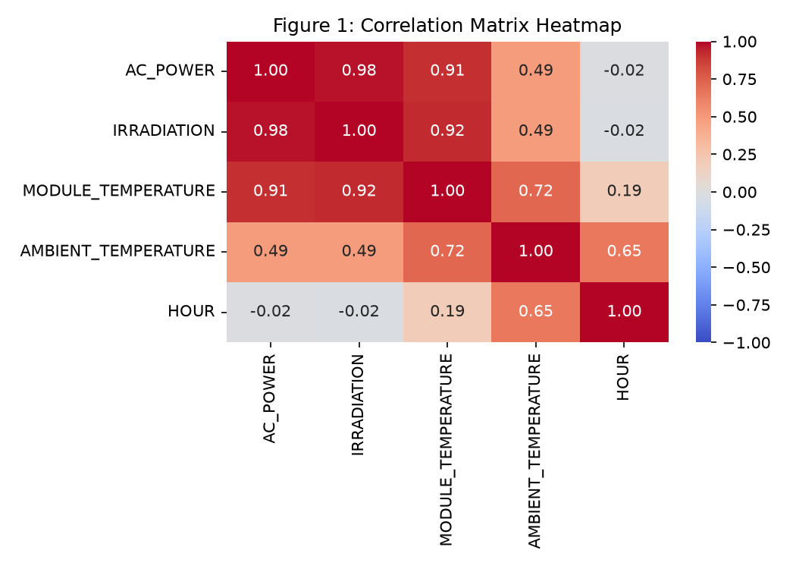
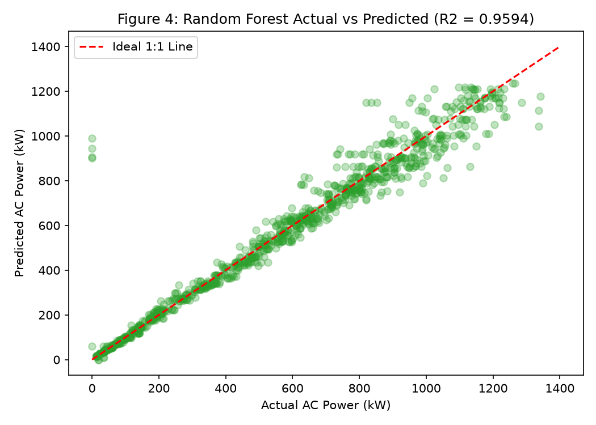
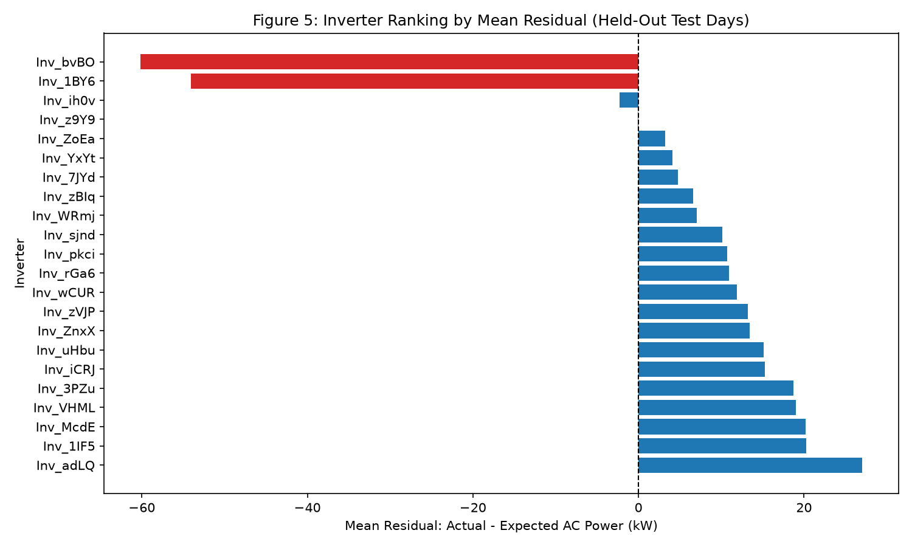
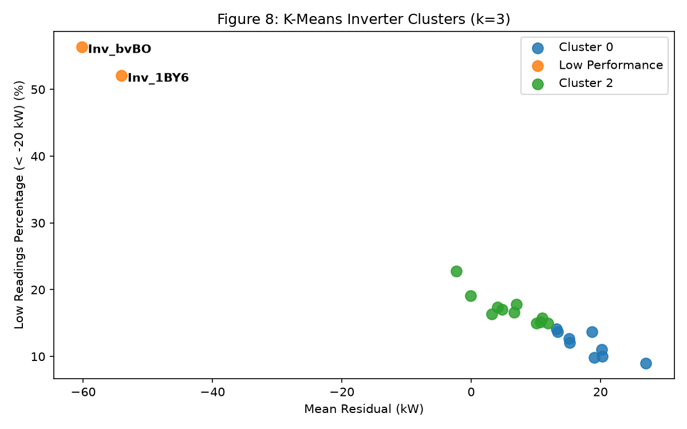

# Solar Inverter Underperformance Analysis

A basic predictive analytics course project investigating whether weather-based expected-power models and unsupervised clustering can identify solar inverters that consistently underperform, and whether those flags remain stable over time.

---

## 1. Problem & Research Question
Solar photovoltaic (PV) plants operate multiple string inverters in parallel. Because solar irradiance and ambient temperature fluctuate throughout the day, low power output alone does not reveal whether an inverter is underperforming or merely shaded by passing clouds.

**Research Question**:  
*Can a weather-based expected-power model identify inverters that consistently underperform, and are those underperformance flags stable over time?*

---

## 2. Dataset & Attribution
- **Dataset**: [Solar Power Generation Data (Kaggle)](https://www.kaggle.com/datasets/anikannal/solar-power-generation-data) by Ani Kannal.
- **Scope**: Plant 1 (22 inverters) monitored over 34 consecutive days (May 15, 2020 to June 17, 2020) at 15-minute intervals.
- **Files Used**:
  - `data/Plant_1_Generation_Data.csv`: Inverter-level power generation (`DATE_TIME`, `PLANT_ID`, `SOURCE_KEY`, `DC_POWER`, `AC_POWER`, `DAILY_YIELD`, `TOTAL_YIELD`).
  - `data/Plant_1_Weather_Sensor_Data.csv`: Weather sensor readings (`DATE_TIME`, `AMBIENT_TEMPERATURE`, `MODULE_TEMPERATURE`, `IRRADIATION`).
- *(Note: Plant 2 files remain in `data/` for archival reference but are unused in this simplified curriculum project).*

---

## 3. Mapping to Course Syllabus Practicals

| Notebook Section | Course Syllabus Topic | Description & Methods Used |
|---|---|---|
| **Section 1** | **Practical 1: Exploring Data** | Data loading, variable types, summary statistics, date range inspection |
| **Section 2** | **Practical 2: Data Preprocessing** | Timestamp merging, missing values, numeric vs categorical identification, daytime filtering (`IRRADIATION > 0.01`), Min-Max scaling |
| **Section 3** | **Practical 3: Correlation & Regression** | Correlation matrix heatmap, Simple Linear Regression, Multiple Linear Regression, Polynomial Regression (deg 2), statsmodels OLS summary |
| **Section 4** | **Practical 10: Model Performance & Ensemble** | Random Forest Regressor, holdout evaluation (RMSE, MAE, $R^2$), model comparison table |
| **Section 5** | **Residual Analysis** | Residual calculation ($\text{Actual} - \text{Expected}$), underperformance ranking, low-reading percentage |
| **Section 6** | **Practical 6: Clustering** | Unsupervised K-Means clustering ($k=2$ and $k=3$), inertia elbow plot, identifying low-performance group |
| **Section 7** | **Stability Analysis** | First-half vs Second-half split, Spearman rank correlation, persistent cluster membership |
| **Section 8** | **Summary & Verification Checks** | Automated self-checks (leakage, chronological split, file existence) and limitations |

---

## 4. Key Predictive Analytics Results

### A. Model Evaluation Comparison (Held-Out 10-Day Test Set)
All models were evaluated on the same 10,736 held-out test rows (June 8–17) with strictly no target leakage ($R^2 < 0.99$):

| Model | Input Features | RMSE (kW) | MAE (kW) | $R^2$ |
|---|---|---|---|---|
| **Simple Linear Regression** | `IRRADIATION` only | 73.31 | 45.50 | 0.9547 |
| **Multiple Linear Regression** | Weather + Hour (MinMax scaled) | 73.72 | 45.99 | 0.9542 |
| **Polynomial Regression (Deg 2)** | Degree 2 polynomial terms | 66.66 | 34.15 | **0.9626** |
| **Random Forest Regressor** | 100 trees, max depth 10 | 69.46 | 35.88 | **0.9594** |




### B. Inverter Underperformance Ranking
Using the Random Forest expected-power model, residuals ($\text{Residual} = \text{Actual} - \text{Expected}$) identify two severe underperformers:

| Rank | Inverter ID | Short ID | Test Readings | Mean Residual (kW) | Median Residual (kW) | Deficit Rate (< -20 kW) |
|---|---|---|---|---|---|---|
| **1** | `bvBOhCH3iADSZry` | `Inv_bvBO` | 488 | **-60.19** | -25.50 | **56.35%** |
| **2** | `1BY6WEcLGh8j5v7` | `Inv_1BY6` | 488 | **-54.06** | -21.43 | **52.05%** |
| **3** | `ih0vzX44oOqAx2f` | `Inv_ih0v` | 488 | **-2.30** | -1.70 | 22.75% |
| **...** | ... | ... | ... | ... | ... | ... |
| **22** | `adLQvlD726eNBSB` | `Inv_adLQ` | 488 | **+27.03** | +19.56 | 9.02% |



### C. K-Means Clustering ($k=3$)
- **Elbow Analysis**: Inertia drops from $2.6351$ ($k=1$) to $0.2457$ ($k=2$) and $0.0915$ ($k=3$).
- **Cluster Segmentation**:
  - **Low-Performance Cluster (Cluster 1)**: Inverters `bvBO` and `1BY6` (Mean Residual = **-57.12 kW**, Low Readings = **54.20%**).
  - **Average Cluster (Cluster 2)**: 11 inverters (Mean Residual = **+6.09 kW**, Low Readings = **17.08%**).
  - **High-Performance Cluster (Cluster 0)**: 9 inverters (Mean Residual = **+18.03 kW**, Low Readings = **11.82%**).



### D. Temporal Stability Across Halves
- **Spearman Rank Correlation**: $\rho = 0.7832$ ($p = 1.63 \times 10^{-5}$) between First-Half (June 8–12) and Second-Half (June 13–17) mean residuals.
- **Persistent Outliers**: Both `bvBO` and `1BY6` are placed in the low-performance group in **both halves** (100% persistent).

---

## 5. How to Run

### Step 1: Clone Repository
```bash
git clone https://github.com/thahseenjafarpp/solar-invertor-underperformance.git
cd solar-invertor-underperformance
```

### Step 2: Install Dependencies
```bash
pip install -r requirements.txt
```

### Step 3: Place Dataset Files
Place the downloaded Kaggle CSV files in `data/`:
- `data/Plant_1_Generation_Data.csv`
- `data/Plant_1_Weather_Sensor_Data.csv`

### Step 4: Open and Run the Notebook
Open [notebooks/solar_analysis.ipynb](notebooks/solar_analysis.ipynb) in VS Code or Jupyter Lab, select your Python kernel, and click **"Run All"**.  
All 8 figures will be saved in `results/figures/` and all 5 tables in `results/tables/`.

For oral presentation and concept walkthroughs, see [EXPLAIN.md](EXPLAIN.md).

---

## 6. Operational Limitations
1. **Observation Duration**: 34 continuous days captures short-term behavior but cannot capture seasonal degradation or long-term soiling.
2. **Plant 1 Only**: Findings apply specifically to Plant 1's physical and electrical layout.
3. **No Fault Labels**: Without maintenance logs, underperformance flags mean **"inspect for maintenance"** rather than definitive equipment failure.
4. **Pooled Training Baseline**: The expected-power model was trained on all 22 inverters pooled together, establishing a peer-relative baseline; systemic plant-wide drops (e.g. grid curtailment or uniform dust) affect all inverters and cannot be isolated from weather alone.

---

## 7. License
This project is licensed under the [MIT License](LICENSE).
